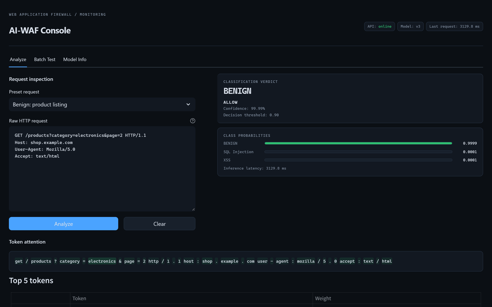
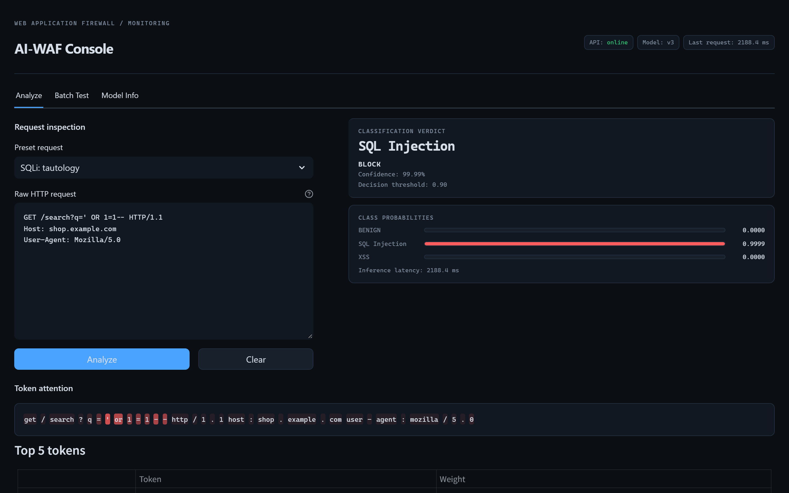
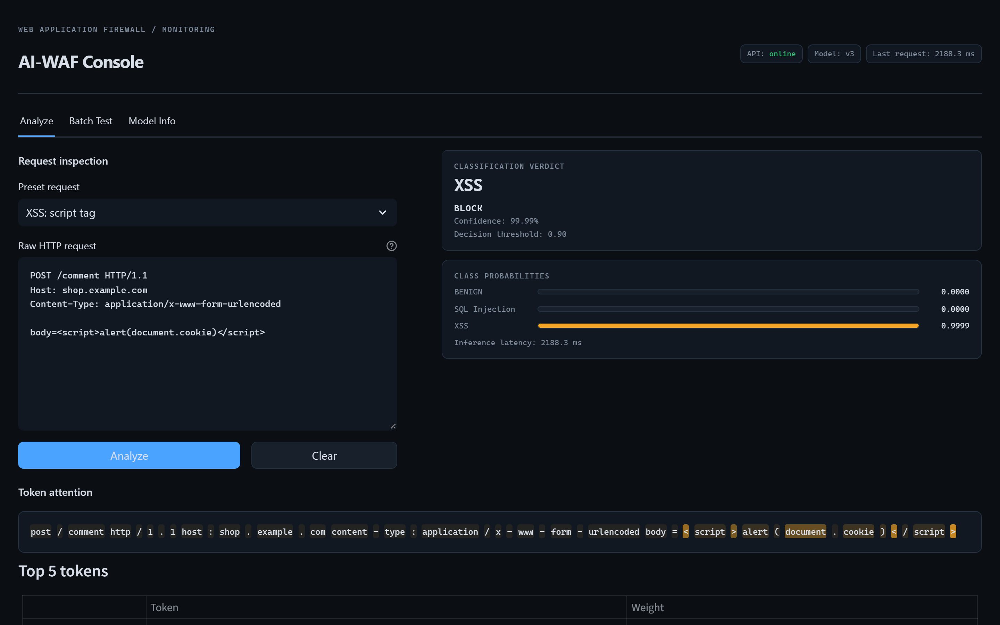

# AI-WAF: AI-Based Web Application Firewall


A fine-tuned **BERT** classifier that reads raw HTTP requests and labels them
**BENIGN**, **SQL Injection** or **XSS**, with confidence scores and a
token-level attention heatmap. Served through **FastAPI** and a **Streamlit** dashboard.

> MCA Research Project (BVIMIT, Navi Mumbai). Research prototype, not production-ready.

---

## Demo

| Benign request | SQL Injection | XSS |
|---|---|---|
|  |  |  |

---

## Why this project

Signature-based WAFs match fixed patterns like `' OR 1=1`. Attackers bypass
them with encoding (`%27%20OR%201%3D1`). Overly aggressive rules also block
legitimate users. AI-WAF learns what the payload *means* in context instead
of matching exact strings.

## Pipeline

```
HTTP Request -> Preprocessing (URL/HTML decode) -> BERT Tokenizer (max 128)
-> BERT Encoder (12 layers) -> Linear(768 -> 3) -> BENIGN / SQLi / XSS
-> FastAPI /predict -> Streamlit (probabilities + attention heatmap)
```

---

## The engineering story: how v2 failed and v3 fixed it

**BERT v2** scored Macro F1 = 1.0000 on its test set, but a normal request
`GET /products?category=electronics&page=2` was classified as **SQL Injection
with 99.99% confidence**.

**Diagnosis** (data analysis of the training set):

| Class | Median length | Median lines |
|---|---|---|
| BENIGN (CSIC 2010) | 562 chars | 17 |
| SQLi (wrapped payloads) | 142 chars | 2 |
| XSS (wrapped payloads) | 141 chars | 2-5 |

The model had learned a shortcut, *"long multi-line request = benign, short = attack"*,
instead of learning payload semantics. A perfect test score was therefore
misleading, because the test set had the same bias.

**BERT v3** rebuilt the dataset with **paired templates**: every attack sample has a
benign counterpart with the identical HTTP structure, differing only in payload.
Adversarial benign samples (`select shoes`, `union jack flag`, `drop shipping guide`)
were added, and payloads were split before templating to avoid leakage.

| | v2 | v3 |
|---|---|---|
| Normal product request | SQLi 99.99% (wrong) | BENIGN 99.99% (correct) |
| Manual real-world tests | failed benign case | 18/18 passed |

---

## Results

| Model | Data | Macro F1 | Note |
|---|---|---|---|
| CNN | CICIDS 2017 (flow features) | 0.7332 | only 3 SQLi samples in test set |
| LSTM | CICIDS 2017 (flow features) | 0.6924 | same limitation |
| BERT v2 | CSIC + Kaggle payloads | 1.0000 | affected by length shortcut |
| BERT v3 | Paired Kaggle payloads | 0.9993 | validated with manual tests |

CNN/LSTM use numerical network-flow features and BERT uses raw HTTP text, so
this is **not a controlled head-to-head comparison**.

Obfuscation test (on v2): URL, HTML, double-URL encoding and case variation
changed Macro F1 by at most 0.16%. Re-running this on v3 is planned.

---

## Quick start

```bash
git clone https://github.com/omyadav3131/AI-WAF.git
cd AI-WAF
python3.11 -m venv .venv
.venv\Scripts\Activate.ps1        # Windows
pip install -r requirements.txt
```

1. Download `bert_best_v3.pt` from **[MODEL_DRIVE_LINK]** and place it in `models/bert/`
2. Terminal 1: `uvicorn api.app:app --host 0.0.0.0 --port 8000 --reload`
3. Terminal 2: `python -m streamlit run streamlit/streamlit_app.py --server.port 8501`
4. Open http://localhost:8501

### API example

```bash
curl -X POST http://localhost:8000/predict -H "Content-Type: application/json" \
  -d '{"request": "GET /search?q=laptop HTTP/1.1\nHost: example.com"}'
```

Returns `label`, `class_id`, `confidence`, `probs`, `tokens`, `attention_weights`.

---

## Limitations

- v3 training and test data are largely **synthetic templates**; real-world traffic has far more variety.
- High test F1 does not prove generalisation to unseen real attacks.
- Only SQLi and XSS are covered (no path traversal, command injection, SSRF, etc.).
- Attention weights are an interpretability aid, not causal proof.
- CPU inference is slow for high-traffic production use.

## Roadmap

- Evaluate on real captured traffic (e.g., DVWA + SQLMap)
- Re-run obfuscation benchmark on v3
- DistilBERT / ONNX for faster inference
- Confidence-tiered response (allow / flag / block)
- Docker packaging

## Datasets

CSIC 2010 HTTP Dataset, Kaggle SQLi and XSS payload datasets (Syed Saqlain Hussain Shah),
CICIDS 2017 (Thursday file). Files are not included; see their original licences.

## Author

**Om Nandkishor Yadav**, MCA, Bharati Vidyapeeth Institute of Management and Information Technology (BVIMIT), Navi Mumbai
